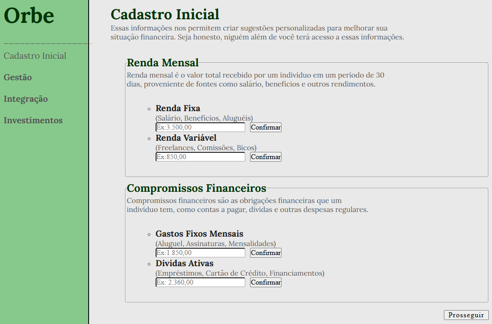

# Orbe — Projeto acadêmico de gestão financeira

A Orbe é um projeto acadêmico em desenvolvimento durante o curso de Análise e Desenvolvimento de Sistemas da FIAP.

Este repositório registra minha evolução nos estudos de programação e desenvolvimento de sistemas. Cada etapa corresponde aos conteúdos estudados e aplicados nas atividades da faculdade.

## Sobre o projeto

A proposta da Orbe é explorar a criação de uma plataforma de gestão financeira pessoal. A ideia inicial envolve o registro de informações financeiras, organização de contas e apresentação futura de orientações adequadas à realidade do usuário.

O projeto ainda está em fase de aprendizado e não representa uma aplicação financeira completa ou pronta para uso.

## Estado atual

Atualmente, o repositório possui:

- uma página estática e responsiva de cadastro financeiro desenvolvida com HTML e CSS;
- classes em Java que possuem lógica de crédito, débito e cálculo de renda;
- implementação de herança com uma superclasse abstrata e duas subclasses, polimorfismo e uma classe de execução `Main`;
- classes que representam usuários, endereços, situações financeiras, contas bancárias e transações;
- scripts SQL, modelo relacional e tabelas criadas no banco Oracle da FIAP;
- uma atividade em Java que acessa o Oracle com o padrão DAO, para as entidades usuário, investimento e instituição bancária;
- **Fase 7 (Integração):** um sistema com back-end em Spring Boot (JPA, camadas Repository, Service e Controller, API REST) conectado ao Oracle da FIAP e um front-end em React com TypeScript, que consome essa API, para as entidades usuário, investimento e instituição bancária;
- histórico de evolução mantido com Git e GitHub.

Ainda não foram implementados:

- autenticação segura de usuários (o login atual é simples, feito para fins de estudo);
- integração com instituições bancárias;
- regras financeiras completas;
- as demais entidades do modelo (contas bancárias, transações, rendas e gastos) na aplicação integrada.

## Evolução do projeto

| Período | Conteúdo estudado | Aplicação no projeto |
|---|---|---|
| Junho de 2026 | HTML5 e CSS3 | Criação da página de cadastro inicial, formulário de renda e compromissos financeiros, Flexbox e responsividade |
| Agosto e setembro de 2026 | Orientação a objetos em Java | Criação das classes principais da Fintech, atributos privados, construtores, métodos, getters, setters e relacionamentos entre objetos |
| Setembro de 2026 | Herança e polimorfismo em Java | Aplicação de superclasse abstrata, subclasses de entrada e saída, sobrescrita, regras de saldo e implementação da classe `Main` |
| Outubro de 2026 | SQL, Oracle e acesso a banco com Java (DAO) | Modelo relacional, criação das tabelas, CRUD em SQL e atividade em Java que acessa o Oracle com o padrão DAO |
| Outubro e novembro de 2026 | Spring Boot, JPA, API REST, React, TypeScript e Vite | Integração completa: back-end, banco Oracle e front-end consumindo a API, para três entidades |

## Interface em HTML e CSS

A primeira página representa o cadastro inicial da situação financeira do usuário. A imagem abaixo apresenta essa primeira versão, desenvolvida com HTML e CSS.



Ela contém campos para:

- renda fixa;
- renda variável;
- gastos fixos;
- dívidas atuais.

A página possui adaptação para computadores, tablets e celulares. Os formulários dessa primeira página ainda não enviam ou armazenam informações.

## Modelagem em Java

A primeira atividade de orientação a objetos foi desenvolvida com cinco classes principais:

- `Usuario`;
- `Endereco`;
- `SituacaoFinanceira`;
- `ContaBancaria`;
- `Transacao`.

Nesta etapa foram praticados:

- definição de classes;
- atributos privados;
- escolha de tipos de dados;
- construtores padrão e parametrizados;
- métodos de instância;
- encapsulamento com getters e setters;
- relacionamentos entre objetos;
- uso de `LocalDate` e `LocalDateTime`.

Na atividade seguinte, o projeto foi ampliado com a criação das classes:

- `TransacaoSaida`;
- `TransacaoEntrada`;
- `Main`.

Como resultado dessa etapa:

- `Transacao` tornou-se uma superclasse abstrata;
- `ContaBancaria` faz a validação e alteração do saldo;
- `TransacaoEntrada` e `TransacaoSaida` foram criadas como subclasses;
- as duas subclasses sobrescrevem o método `processarTransacao()`, realizando entrada e saída de maneiras diferentes;
- `SituacaoFinanceira` calcula a renda total;
- `Endereco` e `Usuario` formatam e retornam seus dados;
- `Main` demonstra as operações e o polimorfismo durante a execução.

## Banco de dados e DAO

Na pasta `sql.fintech` estão os scripts SQL e a imagem do modelo relacional do banco de dados da Orbe, criado no Oracle.

Na pasta `java.dao.sql` está uma atividade em Java que acessa o Oracle usando o padrão DAO, com as entidades usuário, investimento e instituição bancária.

## Fase 7 — Integração

A pasta `fase7` reúne a atividade final da fase, em que as tecnologias estudadas foram conectadas em um único sistema:

- **Back-end** (`fase7/backend`): Java, Spring Boot, JPA, camadas Model, Repository, Service e Controller, e endpoints REST (GET, POST, PUT e DELETE) com os códigos de status HTTP adequados;
- **Banco de dados:** Oracle da FIAP, com o script de criação das tabelas em `fase7/script_fintech_corrigido.sql`;
- **Front-end** (`fase7/frontend`): React, TypeScript, Vite e React Router, com componentes, props, estado, rotas, login, página inicial, página de erro e telas de consulta, cadastro, edição e exclusão para as três entidades.

As instruções para rodar o back-end e o front-end, o usuário de teste e as limitações conhecidas estão em [`fase7/README.md`](fase7/README.md).

## Tecnologias utilizadas

- HTML5;
- CSS3;
- Java;
- SQL e Oracle;
- Spring Boot, JPA/Hibernate e Maven;
- React, TypeScript e Vite;
- Git;
- GitHub;
- IntelliJ IDEA.

## Estrutura atual

```text
Orbe_Fintech/
├── css_html/
│   ├── pagina_1.html
│   └── pagina_1.css
├── Docs/
│   └── Imagens/
│       └── tela-cadastro-inicial.png
├── Java/
│   └── CodificacaoClassesJava/
│       └── src/
│           ├── ContaBancaria.java
│           ├── Endereco.java
│           ├── Main.java
│           ├── SituacaoFinanceira.java
│           ├── Transacao.java
│           ├── TransacaoEntrada.java
│           ├── TransacaoSaida.java
│           └── Usuario.java
├── java.dao.sql/            Atividade Java + Oracle com DAO
├── sql.fintech/             Scripts SQL e modelo relacional
├── fase7/
│   ├── backend/             Spring Boot + JPA + API REST
│   ├── frontend/            React + TypeScript + Vite
│   ├── script_fintech_corrigido.sql
│   └── README.md
├── .gitignore
└── README.md
```

## Como visualizar a página em HTML

Clone o repositório:

```bash
git clone https://github.com/luannstival/Orbe_Fintech.git
```

Depois, abra o arquivo abaixo em um navegador:

```text
css_html/pagina_1.html
```

## Como verificar as classes Java

Abra a pasta abaixo como projeto no IntelliJ IDEA:

```text
Java/CodificacaoClassesJava
```

No IntelliJ, utilize **Build → Build Project** para compilar as classes.

O leitor deverá executar a classe `Main`.
A execução da classe `Main` demonstra as operações de entrada e saída.

## Como rodar a Fase 7

Siga o passo a passo do arquivo [`fase7/README.md`](fase7/README.md). Para rodar, é preciso ter acesso a uma conta do Oracle da FIAP; usuário e senha são informados por variáveis de ambiente e não ficam no código.

## Próximas etapas de aprendizagem

As próximas melhorias serão realizadas de acordo com os conteúdos estudados durante o curso, como:

- autenticação mais segura e proteção das rotas do front-end;
- mensagens de erro nas telas quando a API recusar um dado;
- novas entidades na aplicação integrada (contas bancárias, transações, rendas e gastos);
- ampliação das regras de negócio.

Esses itens representam estudos futuros e ainda não estão implementados.

## Contexto acadêmico

Projeto desenvolvido como parte das atividades do curso de Análise e Desenvolvimento de Sistemas da FIAP.

O objetivo deste repositório é registrar de forma transparente minha evolução como estudante, incluindo o que já aprendi, o que consegui implementar e os próximos conteúdos que serão estudados.

## Autor

**Luann Stival** — estudante de Análise e Desenvolvimento de Sistemas na FIAP.

[LinkedIn](https://linkedin.com/in/luann-stival-6573133b5) · [GitHub](https://github.com/luannstival)

---

Última atualização: novembro de 2026.
